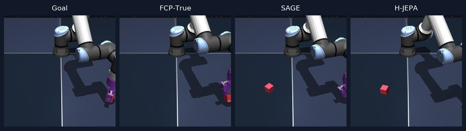
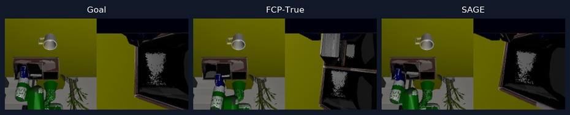

# Imagine Beyond, Plan the Next

**Future-Context Planning with Latent World Models**

FCP predicts future latent states, uses them to choose the next subgoal, and replans from new observations as the agent acts.

[**Model weights and action priors**](https://huggingface.co/stardust8979/FCP-weights) · [**Evaluation datasets**](https://huggingface.co/datasets/stardust8979/FCP-evaluation-tasks) · [**Usage and simulator versions**](USAGE.md)

## Full-task PushT

[](media/pusht_full.mp4)

FCP-True completes this task in **110 actions**. SAGE and H-JEPA reach the **300-action** limit without completing it. [Watch the full video](media/pusht_full.mp4)

## Quick start

1. Clone this repository, enter it, and install the Python dependencies with `pip install -r requirements.txt`.
2. Generate a latent subgoal from the included PushT observation and goal. The command downloads the matching FCP weights on the first run.

   ```bash
   python generate.py --environment pusht --variant true \
     --data examples/pusht_window.npz --output subgoals.npz --device cpu
   ```

3. Use [the training and evaluation guide](USAGE.md) to train on encoded windows, measure held-out error, or connect the matching action prior and frozen world model for closed-loop evaluation. Set up the [simulator for your benchmark](USAGE.md#simulator-versions) before running closed-loop tests.

**FCP-True** trains the subgoal solver with future states from demonstrations. **FCP-Generated** trains it with futures predicted by the frozen future generator. Both use predicted futures during deployment.

## More environments

Each video compares methods from the same initial state and goal. The left panel shows the goal.

| Environment and outcome | Full comparison video |
| --- | --- |
| **Cube H150**<br>FCP-True succeeds. SAGE and H-JEPA fail. | [](media/cube_H150.mp4) |
| **LIBERO Scene2**<br>FCP-True succeeds. SAGE fails. | [](media/scene2.mp4) |
| **LIBERO Caddy**<br>FCP-True succeeds. SAGE fails. | [](media/caddy.mp4) |
| **AntMaze D3**<br>FCP-True succeeds at 213 actions. H-JEPA fails. | [](media/antmaze_D3.mp4) |
| **FourRoom H125**<br>FCP-True succeeds at 229 actions. H-JEPA fails. | [](media/fourroom_H125.mp4) |

## Downloads

- [FCP model weights](https://huggingface.co/stardust8979/FCP-weights) include a shared future generator and separate True and Generated solvers and matching action priors for each of the six environments.
- [FCP evaluation data](https://huggingface.co/datasets/stardust8979/FCP-evaluation-tasks) include 440 full-task PushT trials, 50 AntMaze D3 goals with per-seed initial states, and 50 tasks each for FourRoom H100 and H125.
