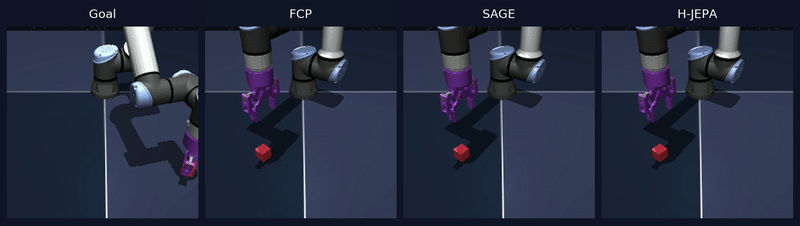
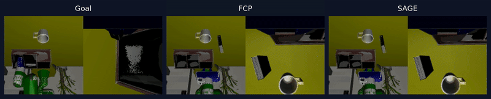
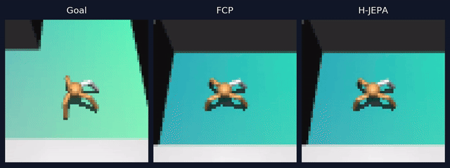
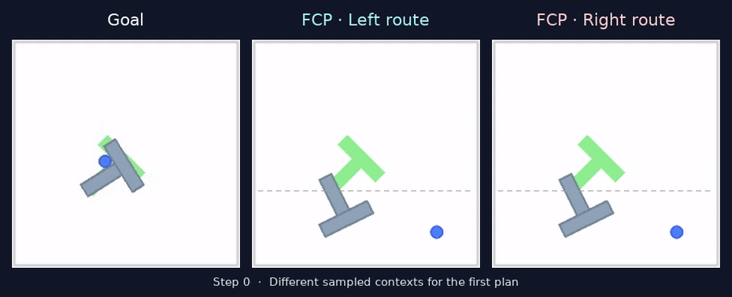
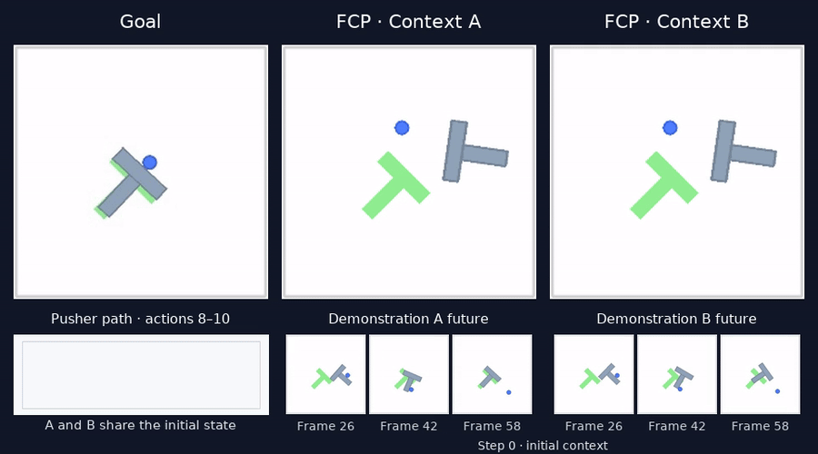

# Imagine Beyond, Plan the Next

**Future-Context Planning with Latent World Models**

[](https://huggingface.co/stardust8979/FCP-weights) [](https://huggingface.co/datasets/stardust8979/FCP-evaluation-tasks)

[Installation](#installation) · [Checkpoints](#checkpoints) · [Data and splits](#data-and-splits) · [Seeds](#seeds) · [Training](#training) · [Evaluation](#evaluation)

## Overview

FCP predicts future states in the world model's latent space and uses them to select the next subgoal. The frozen world model scores actions toward that subgoal, and FCP replans as new observations arrive.

## Full-task PushT


## More comparisons

| Environment | Animated comparison |
| --- | --- |
| **PushT H150** |  |
| **Cube H150** |  |
| **LIBERO Scene2** |  |
| **LIBERO Caddy** |  |
| **AntMaze D3** |  |
| **FourRoom H125** |  |

## PushT: two routes from one start and goal

FCP samples different future contexts for the first plan and then replans closed loop. From the same start and goal, five of eight runs take the left route and three take the right. The lines trace the T-block center. The two displayed runs reach the goal coverage threshold at steps 175 and 246.



[Sampled contexts and trajectories](media/pusht_sampled_routes.npz)

<details>
<summary>Expert future intervention</summary>

FCP starts from the same state and goal with shared random seeds. The first planning call uses future frames from demonstration A or B, and subsequent calls replan as usual. After 10 actions, the pusher positions are 4.37 simulator units apart.



[Demonstration and rollout trajectories](media/pusht_demo_context.npz)

</details>

## Closed-loop success rates

Success rates (%) use the released FCP checkpoints and their matched priors. Segmented means average the six horizons from 25 to 150 steps. Values after ± are sample standard deviations across evaluation groups.

| Method | PushT full task | PushT segmented mean | Cube segmented mean | LIBERO Scene2 | LIBERO Caddy | AntMaze D3 | FourRoom H75 | FourRoom H100 | FourRoom H125 |
| --- | ---: | ---: | ---: | ---: | ---: | ---: | ---: | ---: | ---: |
| FCP-True | **86.82** | **90.72 ± 0.67** | **90.22 ± 1.77** | 61.33 ± 3.06 | 66.00 ± 5.29 | **97.33 ± 1.15** | **100.00** | **100.00** | 48.00 |
| FCP-Generated | 83.18 | 90.11 ± 1.42 | 89.61 ± 0.51 | **70.67 ± 1.15** | **74.67 ± 1.15** | 89.33 ± 4.62 | 84.00 | 90.00 | **52.00** |
| SAGE | 46.59 | 74.72 ± 1.54 | 82.00 ± 0.58 | 48.67 ± 1.15 | 58.00 ± 7.21 | — | — | — | — |
| H-JEPA | 35.00 | 48.22 ± 0.92 | 46.89 ± 2.47 | — | — | 70.00 ± 8.00 | 96.00 | 26.00 | 0.00 |
| HWM | 34.77 | 52.61 ± 1.13 | 52.39 ± 1.42 | — | — | 36.00 ± 3.46 | **100.00** | 4.00 | 0.00 |

AntMaze and FourRoom use the retrained SAGE action priors paired with the released FCP models.

## Installation

```bash
git clone https://github.com/TexasOmertosa/FCP.git
cd FCP
python -m pip install -r requirements.txt
```

The released GPU evaluation recipes use Python 3.10, PyTorch 2.13.0 and CUDA 13.0 for PushT, Cube and LIBERO. Install the matching simulator dependencies in a separate environment for each stack. [Package versions](requirements.txt)

| Environment | Simulator versions |
|---|---|
| PushT | Stable World-Model 0.1.1, Pymunk 7.3.0, Pygame 2.6.1, Gymnasium 1.3.0 |
| Cube | Stable World-Model 0.1.1, OGBench 1.2.1, MuJoCo 3.12.0, Gymnasium 1.3.0 |
| Scene2, Caddy | LIBERO 0.1.0, robosuite 1.4.0, MuJoCo 2.3.7 |
| AntMaze D3 | [H-JEPA AntMaze at `97054ec`](https://github.com/kevinghst/H-JEPA/tree/97054ecaff83e13839195ec4b92d74c08a0127c5/stable_worldmodel/envs/ogbench), MuJoCo 3.14.0, Gymnasium 1.2.3, OGBench 1.2.1, Stable World-Model 0.1.1 |
| FourRoom | Gymnasium 1.2.3, [H-JEPA simulator at `97054ec`](https://github.com/kevinghst/H-JEPA/tree/97054ecaff83e13839195ec4b92d74c08a0127c5) |

## Checkpoints

Use the same frozen lower model and FCG for both variants. Pair each FGSS with its corresponding action prior.

### Frozen lower models

| Environment | Lower model used | Checkpoint | Companion files |
|---|---|---|---|
| PushT | Published LeWM | [weights.pt](https://huggingface.co/quentinll/lewm-pusht/blob/22b330c28c27ead4bfd1888615af1340e3fe9052/weights.pt) | [Config](https://huggingface.co/quentinll/lewm-pusht/blob/22b330c28c27ead4bfd1888615af1340e3fe9052/config.json) |
| Cube | Published LeWM | [weights.pt](https://huggingface.co/quentinll/lewm-cube/blob/b0747c5002e86d2ce8f3cd8178004b97524c587d/weights.pt) | [Config](https://huggingface.co/quentinll/lewm-cube/blob/b0747c5002e86d2ce8f3cd8178004b97524c587d/config.json) |
| LIBERO Scene2 | Frozen SAGE world model | [weights.pt](https://huggingface.co/CLTRAY/SAGE/blob/d81d637d72884d8ef0ad80813d37c583ebfd33c8/libero_scene2/world_model/weights.pt) | [Config](https://huggingface.co/CLTRAY/SAGE/blob/d81d637d72884d8ef0ad80813d37c583ebfd33c8/libero_scene2/world_model/config.json) |
| LIBERO Caddy | Frozen SAGE world model | [weights.pt](https://huggingface.co/CLTRAY/SAGE/blob/d81d637d72884d8ef0ad80813d37c583ebfd33c8/libero_caddy/world_model/weights.pt) | [Config](https://huggingface.co/CLTRAY/SAGE/blob/d81d637d72884d8ef0ad80813d37c583ebfd33c8/libero_caddy/world_model/config.json) |
| AntMaze D3 | FCP retrained LeWM | [lower_E20.pt](https://huggingface.co/stardust8979/FCP-weights/blob/fb370f8f99e46183af641b6639f5dc85974ea067/antmaze/lower_model/lower_E20.pt) | [Config](https://huggingface.co/stardust8979/FCP-weights/blob/fb370f8f99e46183af641b6639f5dc85974ea067/antmaze/lower_model/config.json) · [Normalizer](https://huggingface.co/stardust8979/FCP-weights/blob/fb370f8f99e46183af641b6639f5dc85974ea067/antmaze/lower_model/train_normalizer.json) |
| FourRoom | FCP retrained LeWM | [fourroom_lewm.ckpt](https://huggingface.co/stardust8979/FCP-weights/blob/fb370f8f99e46183af641b6639f5dc85974ea067/fourroom/lower_model/fourroom_lewm.ckpt) | [Config](https://huggingface.co/stardust8979/FCP-weights/blob/fb370f8f99e46183af641b6639f5dc85974ea067/fourroom/lower_model/config.json) · [Normalizer](https://huggingface.co/stardust8979/FCP-weights/blob/fb370f8f99e46183af641b6639f5dc85974ea067/fourroom/lower_model/normalizer.pt) |

The AntMaze D3 and FourRoom downloads include the normalization statistics used in evaluation. The two models were retrained using the H-JEPA implementation. [Source revision](https://github.com/kevinghst/H-JEPA/tree/97054ecaff83e13839195ec4b92d74c08a0127c5).

### FCP and action priors

FCG is shared by FCP-True and FCP-Generated within each environment. Use the upper model config and the prior metadata alongside the selected weights.

| Environment | FCG | FGSS | Action prior | Configuration |
|---|---|---|---|---|
| PushT | [Shared](https://huggingface.co/stardust8979/FCP-weights/blob/fb370f8f99e46183af641b6639f5dc85974ea067/pusht/fcg.safetensors) | [True](https://huggingface.co/stardust8979/FCP-weights/blob/fb370f8f99e46183af641b6639f5dc85974ea067/pusht/fgss_true.safetensors) · [Generated](https://huggingface.co/stardust8979/FCP-weights/blob/fb370f8f99e46183af641b6639f5dc85974ea067/pusht/fgss_generated.safetensors) | [True](https://huggingface.co/stardust8979/FCP-weights/blob/fb370f8f99e46183af641b6639f5dc85974ea067/pusht/action_prior_true.safetensors) · [Generated](https://huggingface.co/stardust8979/FCP-weights/blob/fb370f8f99e46183af641b6639f5dc85974ea067/pusht/action_prior_generated.safetensors) | [Upper config](https://huggingface.co/stardust8979/FCP-weights/blob/fb370f8f99e46183af641b6639f5dc85974ea067/pusht/config.json) · [Prior metadata](https://huggingface.co/stardust8979/FCP-weights/blob/fb370f8f99e46183af641b6639f5dc85974ea067/pusht/action_priors.json) |
| Cube | [Shared](https://huggingface.co/stardust8979/FCP-weights/blob/fb370f8f99e46183af641b6639f5dc85974ea067/cube/fcg.safetensors) | [True](https://huggingface.co/stardust8979/FCP-weights/blob/fb370f8f99e46183af641b6639f5dc85974ea067/cube/fgss_true.safetensors) · [Generated](https://huggingface.co/stardust8979/FCP-weights/blob/fb370f8f99e46183af641b6639f5dc85974ea067/cube/fgss_generated.safetensors) | [True](https://huggingface.co/stardust8979/FCP-weights/blob/fb370f8f99e46183af641b6639f5dc85974ea067/cube/action_prior_true.safetensors) · [Generated](https://huggingface.co/stardust8979/FCP-weights/blob/fb370f8f99e46183af641b6639f5dc85974ea067/cube/action_prior_generated.safetensors) | [Upper config](https://huggingface.co/stardust8979/FCP-weights/blob/fb370f8f99e46183af641b6639f5dc85974ea067/cube/config.json) · [Prior metadata](https://huggingface.co/stardust8979/FCP-weights/blob/fb370f8f99e46183af641b6639f5dc85974ea067/cube/action_priors.json) |
| LIBERO Scene2 | [Shared](https://huggingface.co/stardust8979/FCP-weights/blob/fb370f8f99e46183af641b6639f5dc85974ea067/scene2/fcg.safetensors) | [True](https://huggingface.co/stardust8979/FCP-weights/blob/fb370f8f99e46183af641b6639f5dc85974ea067/scene2/fgss_true.safetensors) · [Generated](https://huggingface.co/stardust8979/FCP-weights/blob/fb370f8f99e46183af641b6639f5dc85974ea067/scene2/fgss_generated.safetensors) | [True](https://huggingface.co/stardust8979/FCP-weights/blob/fb370f8f99e46183af641b6639f5dc85974ea067/scene2/action_prior_true.safetensors) · [Generated](https://huggingface.co/stardust8979/FCP-weights/blob/fb370f8f99e46183af641b6639f5dc85974ea067/scene2/action_prior_generated.safetensors) | [Upper config](https://huggingface.co/stardust8979/FCP-weights/blob/fb370f8f99e46183af641b6639f5dc85974ea067/scene2/config.json) · [Prior metadata](https://huggingface.co/stardust8979/FCP-weights/blob/fb370f8f99e46183af641b6639f5dc85974ea067/scene2/action_priors.json) |
| LIBERO Caddy | [Shared](https://huggingface.co/stardust8979/FCP-weights/blob/fb370f8f99e46183af641b6639f5dc85974ea067/caddy/fcg.safetensors) | [True](https://huggingface.co/stardust8979/FCP-weights/blob/fb370f8f99e46183af641b6639f5dc85974ea067/caddy/fgss_true.safetensors) · [Generated](https://huggingface.co/stardust8979/FCP-weights/blob/fb370f8f99e46183af641b6639f5dc85974ea067/caddy/fgss_generated.safetensors) | [True](https://huggingface.co/stardust8979/FCP-weights/blob/fb370f8f99e46183af641b6639f5dc85974ea067/caddy/action_prior_true.safetensors) · [Generated](https://huggingface.co/stardust8979/FCP-weights/blob/fb370f8f99e46183af641b6639f5dc85974ea067/caddy/action_prior_generated.safetensors) | [Upper config](https://huggingface.co/stardust8979/FCP-weights/blob/fb370f8f99e46183af641b6639f5dc85974ea067/caddy/config.json) · [Prior metadata](https://huggingface.co/stardust8979/FCP-weights/blob/fb370f8f99e46183af641b6639f5dc85974ea067/caddy/action_priors.json) |
| AntMaze D3 | [Shared](https://huggingface.co/stardust8979/FCP-weights/blob/fb370f8f99e46183af641b6639f5dc85974ea067/antmaze/fcg.safetensors) | [True](https://huggingface.co/stardust8979/FCP-weights/blob/fb370f8f99e46183af641b6639f5dc85974ea067/antmaze/fgss_true.safetensors) · [Generated](https://huggingface.co/stardust8979/FCP-weights/blob/fb370f8f99e46183af641b6639f5dc85974ea067/antmaze/fgss_generated.safetensors) | [True](https://huggingface.co/stardust8979/FCP-weights/blob/fb370f8f99e46183af641b6639f5dc85974ea067/antmaze/action_prior_true.safetensors) · [Generated](https://huggingface.co/stardust8979/FCP-weights/blob/fb370f8f99e46183af641b6639f5dc85974ea067/antmaze/action_prior_generated.safetensors) | [Upper config](https://huggingface.co/stardust8979/FCP-weights/blob/fb370f8f99e46183af641b6639f5dc85974ea067/antmaze/config.json) · [Prior metadata](https://huggingface.co/stardust8979/FCP-weights/blob/fb370f8f99e46183af641b6639f5dc85974ea067/antmaze/action_priors.json) |
| FourRoom | [Shared](https://huggingface.co/stardust8979/FCP-weights/blob/fb370f8f99e46183af641b6639f5dc85974ea067/fourroom/fcg.safetensors) | [True](https://huggingface.co/stardust8979/FCP-weights/blob/fb370f8f99e46183af641b6639f5dc85974ea067/fourroom/fgss_true.safetensors) · [Generated](https://huggingface.co/stardust8979/FCP-weights/blob/fb370f8f99e46183af641b6639f5dc85974ea067/fourroom/fgss_generated.safetensors) | [True](https://huggingface.co/stardust8979/FCP-weights/blob/fb370f8f99e46183af641b6639f5dc85974ea067/fourroom/action_prior_true.safetensors) · [Generated](https://huggingface.co/stardust8979/FCP-weights/blob/fb370f8f99e46183af641b6639f5dc85974ea067/fourroom/action_prior_generated.safetensors) | [Upper config](https://huggingface.co/stardust8979/FCP-weights/blob/fb370f8f99e46183af641b6639f5dc85974ea067/fourroom/config.json) · [Prior metadata](https://huggingface.co/stardust8979/FCP-weights/blob/fb370f8f99e46183af641b6639f5dc85974ea067/fourroom/action_priors.json) |

## Data and splits

Split counts are in train / validation / test order where applicable. The preparation commands read the fixed episode CSVs.

| Environment | Demonstrations | Fixed episode split | Evaluation tasks |
|---|---|---|---|
| PushT | [`pusht_expert_train.h5.zst`](https://huggingface.co/datasets/quentinll/lewm-pusht/blob/655cd446b9929369d7d406001da85c15d1457850/pusht_expert_train.h5.zst) | [CSV](data/splits/pusht_episode_split.csv), 14,948 / 1,868 / 1,869 | [Full440 task data and index](https://huggingface.co/datasets/stardust8979/FCP-evaluation-tasks/tree/00ccb6c343e053aac5c079bb96e9ee396e8aef9b/pusht) |
| Cube | [`cube_single_expert.tar.zst`](https://huggingface.co/datasets/quentinll/lewm-cube/blob/02a19a67a0dc8c9d6215f89c19e0a597691e152a/cube_single_expert.tar.zst) | [CSV](data/splits/cube_episode_split.csv), 8,000 / 1,000 / 1,000 | [Fixed episode IDs and start frames by seed and horizon](fcp/closed_loop/cube_tasks.json) |
| Scene2 | [SAGE training archives](https://huggingface.co/datasets/CLTRAY/SAGE-data/tree/7e87e5b0fee414a70945a310d08e18d2f92cffba/training) | [CSV](data/splits/scene2_train_val_episode_index.csv), 8,000 / 1,000 | [Scene2 evaluation archive](https://huggingface.co/datasets/CLTRAY/SAGE-data/blob/7e87e5b0fee414a70945a310d08e18d2f92cffba/evaluation/libero_scene2_evaluation.tar) · [Fixed queries](fcp/closed_loop/libero_tasks.json) |
| Caddy | [SAGE training archives](https://huggingface.co/datasets/CLTRAY/SAGE-data/tree/7e87e5b0fee414a70945a310d08e18d2f92cffba/training) | [CSV](data/splits/caddy_train_val_episode_index.csv), 8,000 / 1,000 | [Caddy evaluation archive](https://huggingface.co/datasets/CLTRAY/SAGE-data/blob/7e87e5b0fee414a70945a310d08e18d2f92cffba/evaluation/libero_caddy_evaluation.tar) · [Fixed queries](fcp/closed_loop/libero_tasks.json) |
| AntMaze | [Train HDF5](https://huggingface.co/datasets/jepa-world-models/h-jepa/blob/cc05cb8d2aaf9aec0d5364d073c6369ff760b60b/visual_antmaze_medium_explore_stitch_train.h5) · [Val HDF5](https://huggingface.co/datasets/jepa-world-models/h-jepa/blob/cc05cb8d2aaf9aec0d5364d073c6369ff760b60b/visual_antmaze_medium_stitch_val.h5) | [CSV](data/splits/antmaze_episode_split.csv), 25,000 / 500 | [Original H-JEPA D3 tasks](https://huggingface.co/datasets/jepa-world-models/h-jepa/blob/cc05cb8d2aaf9aec0d5364d073c6369ff760b60b/eval_trajs/ant/expert_grid_d3_n50.pt) |
| FourRoom | [Train HDF5](https://huggingface.co/datasets/jepa-world-models/h-jepa/blob/cc05cb8d2aaf9aec0d5364d073c6369ff760b60b/fourroom_tp35_d1.h5) · [Val HDF5](https://huggingface.co/datasets/jepa-world-models/h-jepa/blob/cc05cb8d2aaf9aec0d5364d073c6369ff760b60b/fourroom_tp35_d1_val.h5) | [CSV](data/splits/fourroom_episode_split.csv), 2,494 / 100 | [Original H-JEPA H75 tasks](https://huggingface.co/datasets/jepa-world-models/h-jepa/blob/cc05cb8d2aaf9aec0d5364d073c6369ff760b60b/eval_trajs/fourroom/fourroom_tp35_cross2_goal75_n50_d1.pt) · [FCP H100 and H125 task data](https://huggingface.co/datasets/stardust8979/FCP-evaluation-tasks/tree/00ccb6c343e053aac5c079bb96e9ee396e8aef9b/fourroom) |

Use the [SAGE extraction instructions](https://huggingface.co/datasets/CLTRAY/SAGE-data#extract) for the multipart LIBERO archives.

## Seeds

Training seeds below are the public defaults. Evaluation uses the listed seed groups or fixed task manifests.

| Environment | Split | FCG / FGSS | Action prior | Evaluation |
|---|---|---|---:|---|
| PushT | 42 | 148 / 148 | 149 | Full task 42, 440 tasks. Segmented 22, 32, 42, 100 tasks per seed and horizon. |
| Cube | 42 | 148 / 148 | 149 | 22, 32, 42, 100 tasks per seed and horizon. |
| Scene2 | Fixed episode CSV | 217 / 218 | 218 | 150 fixed queries in groups seeded with 8501, 8502 and 8503, 50 per group. |
| Caddy | Fixed episode CSV | 217 / 218 | 218 | 150 fixed queries in three groups of 50. Reset seeds are recorded per query. |
| AntMaze D3 | 42 for validation selection | 42 / 42 | 149 | 42, 43, 44, 50 tasks per seed. |
| FourRoom | 0 | 44 / 44 | 149 | Base seed 42, 50 tasks per horizon for H75, H100 and H125. |

Both LIBERO suites use PyTorch seed 42 for evaluation. The fixed query manifest records simulator reset seeds for both suites.

The retrained AntMaze and FourRoom lower LeWM models use training seeds 42 and 44, respectively. Open-loop evaluation uses seed 1209 by default. Initialization, noise and cache seeds are set by the training and cache code.

## Training

Encode demonstrations with the frozen lower model. Provide an NPZ with `latents` and `episode_offsets`, and an NPY of start and goal frame pairs. Keep the episodes in source order or include `episode_ids`. For AntMaze and FourRoom, pass the original HDF5 basename with `--source-file`. Rebuilding the original training windows also requires the original frame pairs and any custom supervision indices.

The example trains a shared FCG and a Generated FGSS on PushT.

```bash
for split in train val; do
  python -m fcp.prepare --environment pusht --split "$split" \
    --episodes episodes.npz --pairs pairs.npy --output "${split}.npz"
done
python -m fcp.train --environment pusht --stage fcg --train train.npz --val val.npz --output fcg.pt
for split in train val; do
  python -m fcp.generate --environment pusht --output-kind future --split "$split" \
    --checkpoint fcg.pt --data "${split}.npz" --output "${split}_future.npz"
done
python -m fcp.train --environment pusht --stage fgss --condition generated \
  --fcg-checkpoint fcg.pt --future-cache train_future.npz --val-future-cache val_future.npz \
  --train train.npz --val val.npz --output generated.pt
```

For True, use `--condition true`, drop `--future-cache`, and save to `true.pt`. Train each variant’s prior with `python -m priors.prepare`, `python -m priors.cache`, and `python -m priors.train`. Prior preparation uses the same `--split` and reads the aligned expert actions. Run each command with `--help` for its arguments.

## Evaluation

For PushT, install the packages marked `pusht` in `requirements.txt` and run the released model. The command downloads the pinned weights, prior and task data.

```bash
sed -n 's/^# pusht: //p' requirements.txt | xargs python -m pip install -r requirements.txt
python -m fcp.closed_loop.pusht --variant true --output runs/pusht_true.json
```

Use `--variant generated` for the matching Generated weights and prior. For Cube and LIBERO use `python -m fcp.closed_loop.cube` or `python -m fcp.closed_loop.libero` with the corresponding data and simulator setup. Cube defaults to seed 22. Run seeds 22, 32 and 42 for the full Cube comparison. LIBERO uses the pinned [SAGE checkout](https://github.com/PKU-ML/SAGE/tree/fbdb018489e2cdf27f0a8ad692746db4be596b6e) and [LIBERO checkout](https://github.com/Lifelong-Robot-Learning/LIBERO/tree/8f1084e3132a39270c3a13ebe37270a43ece2a01).

For open-loop evaluation on encoded windows, use `python -m fcp.evaluate --environment pusht --variant true --data test.npz`. AntMaze and FourRoom closed-loop evaluation uses the same module with a navigation backend supplied through `--backend`.
