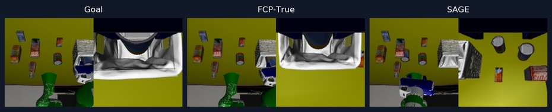
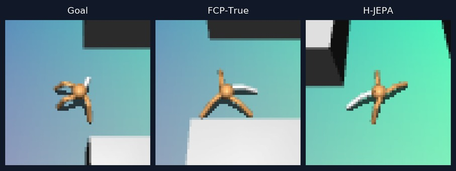
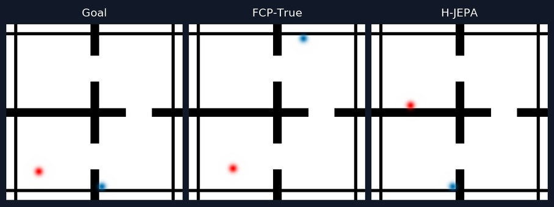

# Imagine Beyond, Plan the Next

**Future-Context Planning with Latent World Models**

FCP predicts a future task context and uses it to select the next subgoal for closed-loop visual planning.

[Model weights](https://huggingface.co/stardust8979/FCP-weights) · [Evaluation datasets](https://huggingface.co/datasets/stardust8979/FCP-evaluation-tasks) · [Training, generation, and evaluation](USAGE.md)

## Full-task PushT

FCP-True completes the task in **110 actions**. SAGE and H-JEPA reach the **300-action** budget without completing the same task. [Watch full video](media/pusht_full.mp4)

## More environments

The videos show selected trials with the same initial state and goal for the compared methods. The left panel shows the goal. The AntMaze and FourRoom examples use the latest released navigation priors.

| Environment and outcome | Full comparison video |
| --- | --- |
| **Cube H150** FCP-True succeeds. SAGE and H-JEPA fail. |  |
| **LIBERO Scene2** FCP-True succeeds. SAGE fails. |  |
| **LIBERO Caddy** FCP-True succeeds. SAGE fails. |  |
| **AntMaze D3** FCP-True succeeds at 213 actions. H-JEPA fails. |  |
| **FourRoom H125** FCP-True succeeds at 229 actions. H-JEPA fails. |  |

## Downloads

- FCP-True and FCP-Generated upper weights for all six environments, with one shared FCG, two FGSS checkpoints, and both matching action priors per environment. [Hugging Face model repository](https://huggingface.co/stardust8979/FCP-weights)
- 440 full-task PushT trajectories, 50 AntMaze D3 tasks, and 50 FourRoom tasks each for H100 and H125. [Hugging Face dataset repository](https://huggingface.co/datasets/stardust8979/FCP-evaluation-tasks)
