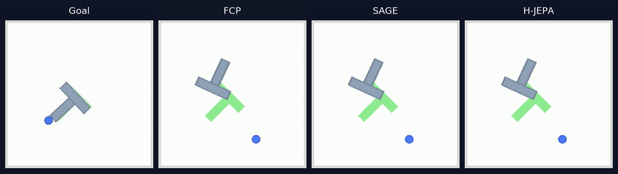
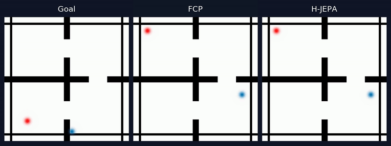

# Imagine Beyond, Plan the Next

**Future-Context Planning with Latent World Models**

FCP predicts future latent states to choose its next subgoal, then replans from new observations as the agent acts.

[**Model weights and action priors**](https://huggingface.co/stardust8979/FCP-weights) · [**Evaluation datasets**](https://huggingface.co/datasets/stardust8979/FCP-evaluation-tasks) · [**Usage and reproduction**](USAGE.md) · [**Original checkpoints and data**](ASSETS.md)

## Full-task PushT

[](media/pusht_full.mp4)

FCP completes this task in **110 actions**. SAGE and H-JEPA reach the **300-action** limit. [Play or download the full MP4](media/pusht_full.mp4)

## Comparison videos

The goal is on the left in each video. Each comparison starts from the same initial state and goal. The clips below continue for one second after FCP reaches the goal.

| Environment | Animated comparison |
| --- | --- |
| **Cube H150** · [MP4](media/cube_H150.mp4) | [](media/cube_H150.mp4) |
| **LIBERO Scene2** · [MP4](media/scene2.mp4) | [](media/scene2.mp4) |
| **LIBERO Caddy** · [MP4](media/caddy.mp4) | [](media/caddy.mp4) |
| **AntMaze D3** · [MP4](media/antmaze_D3.mp4) | [](media/antmaze_D3.mp4) |
| **FourRoom H125** · [MP4](media/fourroom_H125.mp4) | [](media/fourroom_H125.mp4) |

## Quick start

From the repository root, install the dependencies and run the included PushT latent window. The first run downloads the selected checkpoint.

```bash
pip install -r requirements.txt
python generate.py --environment pusht --variant true \
  --data examples/pusht_window.npz --output subgoals.npz --device cpu
```

Run `python reproduce.py --environment pusht` to compare both training variants with their published reference predictions. Omit the environment to verify all 12 configurations. Follow the [usage guide](USAGE.md) for upper-model training, [action-prior training](priors/README.md), native PushT evaluation, and all six simulator setups.
