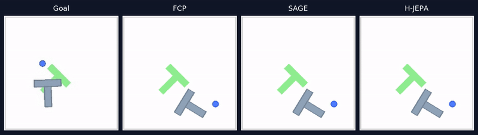
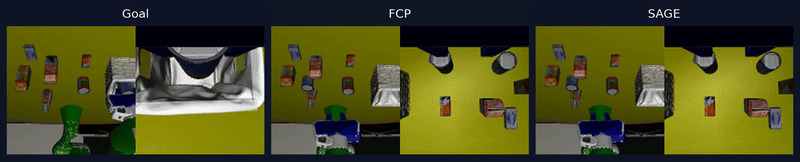

# Imagine Beyond, Plan the Next

**Future-Context Planning with Latent World Models**

[](https://huggingface.co/stardust8979/FCP-weights) [](https://huggingface.co/datasets/stardust8979/FCP-evaluation-tasks) [](USAGE.md) [](ASSETS.md)

## Overview

FCP predicts future states in the world model's latent space and uses them to select the next subgoal. The frozen world model scores actions toward that subgoal, and FCP replans as new observations arrive.

## Full-task PushT

[](media/pusht_full.mp4)

FCP completes this task in **110 actions**. SAGE and H-JEPA reach the **300-action** limit. [Full-task MP4](media/pusht_full.mp4)

## More comparisons

Each comparison uses the same start and goal for the displayed methods. The goal is on the left. These clips continue for 20 video frames after FCP reaches the goal.

| Environment | Animated comparison |
| --- | --- |
| **PushT H150** · [MP4](media/pusht_H150.mp4) | [](media/pusht_H150.mp4) |
| **Cube H150** · [MP4](media/cube_H150.mp4) | [](media/cube_H150.mp4) |
| **LIBERO Scene2** · [MP4](media/scene2.mp4) | [](media/scene2.mp4) |
| **LIBERO Caddy** · [MP4](media/caddy.mp4) | [](media/caddy.mp4) |
| **AntMaze D3** · [MP4](media/antmaze_D3.mp4) | [](media/antmaze_D3.mp4) |
| **FourRoom H125** · [MP4](media/fourroom_H125.mp4) | [](media/fourroom_H125.mp4) |

## Repository layout

```text
FCP/
├── fcp/                  # FCG/FGSS models, data, training, generation, and evaluation
│   └── closed_loop/      # Action search and native PushT evaluation
├── priors/               # Action-prior model, data, cache, training, and weights
├── media/                # Project videos and animated previews
├── USAGE.md              # Commands and simulator setup
└── ASSETS.md             # Checkpoint and dataset sources
```

## Quick start

```bash
git clone https://github.com/TexasOmertosa/FCP.git
cd FCP
python -m pip install -r requirements.txt
```

Prepare encoded observations and goals, then run `python -m fcp.generate` to generate subgoals or `python -m fcp.evaluate` to measure prediction error. The commands download the matching FCP weights. [Input format and commands](USAGE.md)

## Training and evaluation

Train the future generator first. Reuse it to fit the True solver with demonstrated futures or the Generated solver with predicted futures. Then train an action prior for the selected upper weights. [Upper-model training](USAGE.md#train-generate-and-test) · [Action-prior training](priors/README.md)

For closed-loop evaluation, install the simulator stack for your benchmark and use its matching frozen world model. [Native PushT](USAGE.md#native-pusht-evaluation) · [Simulator versions](USAGE.md#simulator-versions) · [Original LeWM, SAGE, and H-JEPA assets](ASSETS.md)
